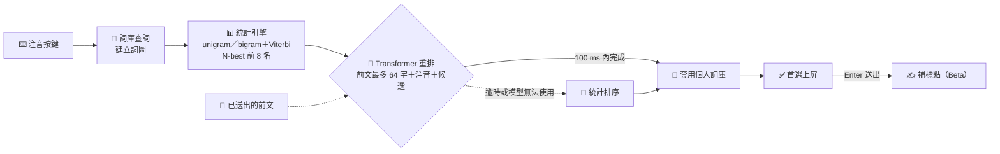
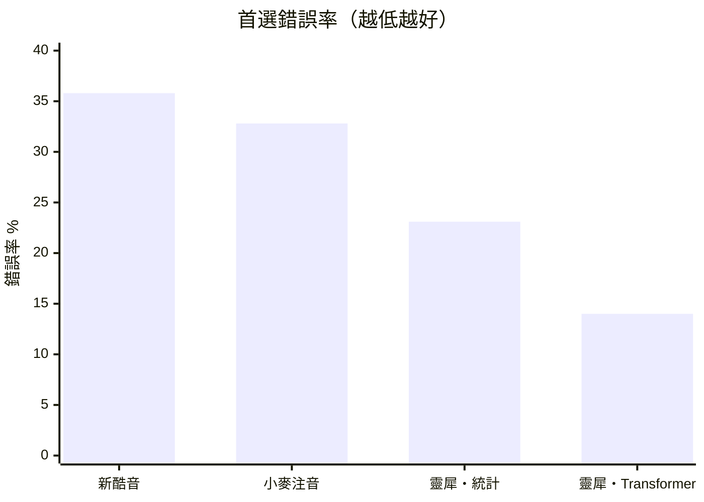

# 靈犀注音（0c）開源版 ⌨️

> **免選字，把話打完。** 用本機的 Transformer 語言模型看前文選字，打一整句注音，不用停下來挑同音字。

`ime-oss` 包含輸入法核心、平台外殼、設定程式、詞庫工具與回歸測試，提供 Linux 發行版維護者及自行建置的開發者使用。一般使用者請到 [官網下載](https://0c.biggo.com/download/)。

## ✨ 特色

- 🧠 **Transformer 選字**：自行訓練的語言模型參考整段前文與注音判斷同音字，大多數時候不必手動選字。
- ⇥ **Tab 補全**：有把握才提示後續字詞，按 Tab 接受；補全只來自詞庫與個人片語，不生成新內容。
- 🔒 **全在本機**：選字、補標點與個人學習都在你的電腦上以 CPU 執行，不連網、不上傳打字內容。
- 📚 **我的詞彙**：常用人名、術語、英文指令加進來就排在前面；學到的用詞存在本機的個人詞庫。
- 🔤 **中英混打、模糊音、Emoji 與顏文字**：ㄗ／ㄓ、ㄘ／ㄔ、ㄙ／ㄕ、ㄣ／ㄥ 近音在後備選；按 = 開 Emoji 選單。
- ✍️ **送出時補標點**（Beta，預設關閉）：Enter 送出時在漢字之間補上 ，。？！、；，不改動你打的字。
- 🛟 **自動退回**：模型無法啟動或回應太慢時改用統計引擎排序，打字不會卡住。

## 🎯 免選字是怎麼做到的

傳統注音輸入法靠詞庫與詞頻挑字，只看得到相鄰的一兩個詞。靈犀注音在統計引擎之上加了一層 Transformer 重排：



1. **列出可能的句子** 📖：依注音在詞庫找出所有可能的字詞，以 unigram／bigram 統計語言模型與 Viterbi 在詞圖上搜尋最可能的組合，打字時即時更新。
2. **Transformer 重排** 🧠：讀入剛送出、游標仍緊接其後的前文（最多 64 字）、目前的注音與每個候選，替前 8 名重新評分。attention 能同時參考整段前文，不只看緊鄰的詞。
3. **本機學習** 👤：你選過、改過的字詞記在本機個人詞庫，下次同樣的情況優先出現。
4. **有把握才補全** ⇥：後續字詞的信心夠高時才顯示 Tab 建議。

### 📈 封存測試：首選錯誤少約六成

在事前凍結、模型沒看過的台灣新聞測試（2026-09-24〜26，共 6,000 例，一半是困難的同音短詞）上，首選錯誤比新酷音少約六成：

| 方法 | 首選正確率 | 首選錯誤率 |
|---|---:|---:|
| 新酷音 0.11.0 | 64.2% | 35.8% |
| 小麥注音 | 67.2% | 32.8% |
| 靈犀注音（只用統計引擎） | 76.9% | 23.1% |
| **靈犀注音（Transformer 重排）** | **86.0%／86.1%** | **14.0%** |



測試規格、成功標準與評分程式都在讀取資料前凍結，只評一次；讀音由字典合成、答案取原文，不是真人打字紀錄。外部輸入法採對它們最有利的輸入方式、無個人詞庫。靈犀注音的兩個數字來自兩個不同的訓練種子。「只用統計引擎」也就是模型無法啟動時的表現。免選字是目標而非保證：罕見人名與詞庫外的詞仍可能要手動選。

### 🧩 模型

| | 選字（`models/select/`） | 補標點（`models/punct/`） |
|---|---|---|
| 架構 | 因果 Transformer decoder：8 層、寬度 512、8 個 attention head，約 3,261 萬參數 | 雙向 Transformer encoder |
| 輸入 | 前文（最多 64 字）＋注音＋候選 | 送出的文字，不看前文 |
| 上游 | [Funmula/0c-sequence-d512](https://huggingface.co/Funmula/0c-sequence-d512) | [Funmula/0c-punct-d512](https://huggingface.co/Funmula/0c-punct-d512) |

模型從零開始訓練，不使用通用大型語言模型的權重，採用 RoPE、GeGLU 等現代化元件。一般桌機 CPU 上選字的 P95 延遲約 7 ms（短片段）至 16 ms（長片段）；兩個模型合計約 250 MB。密碼欄位、暫停學習及英數模式下不送任何文字給模型。更多數字與方法見官網 [選字技術](https://0c.biggo.com/technology/)。

## 🖥️ 支援平台

| 平台 | 外殼與建置說明 |
|---|---|
| 🐧 Linux Fcitx5 | [C++ 外殼](platforms/linux-fcitx5/README.md) |
| 🐧 Linux IBus | [Go 外殼](platforms/linux-ibus/README.md) |
| 🍎 macOS | [InputMethodKit 外殼](platforms/macos/README.md) |
| 🪟 Windows | [TSF 外殼](platforms/windows/README.md) |

## 🛠️ 開始開發

核心需要 Go 1.26 以上；測試與發佈工具使用 Python 3.11 以上。首次建置須先備妥 `go.mod`／`go.sum` 所列模組。以下指令在 repo 根目錄執行，不安裝或重啟桌面輸入法：

```sh
go test ./...
go vet ./...
go run ./cmd/0c-compile -public -bigram '' -out build/public-data
go run ./cmd/0c-cli -data build/public-data
```

這會從 repo 內的詞庫與 unigram 編譯公開資料包，並檢查實際使用來源的版本、可散布標記與授權聲明。它沒有 bigram，不等同完整出貨字典，也尚未與內附神經模型配對。詞庫格式與完整資料限制見 [詞庫資料](data/README.md)，目錄配置見 [專案範圍](REPOSITORIES.md)。

平台外殼另需各自的 C++／Rust／Swift 工具鏈與系統函式庫。設定程式建置入口見 [設定程式](platforms/settings/README.md)。

## ✅ 檢查與測試

```sh
python3 scripts/check_public_tree.py
go test ./...
go vet ./...
make -C platforms/linux-fcitx5 test
make test-upgrade
make test-release
```

Fcitx5 測試需要 Linux 與 C++ 建置工具。設定程式和各平台原生建置另依其 README 驗證。一般測試不修改日常桌面或個人詞庫。

`check_public_tree.py` 檢查 Git 已追蹤及可加入的路徑；原始碼發佈工具也檢查 tag 的完整 Git tree。被 `export-ignore` 隱藏的私人檔案仍會被拒絕。提交前仍須審閱內容；路徑檢查不等同完整機密掃描。

## 📦 原始碼發佈

GitHub Release 提供 `ime-oss-<版本>.tar.xz` 與 `SHA256SUMS`。tarball 交付程式原始碼、可直接使用的統計字典與兩個已配對模型，供維護者編譯同一版本的輸入法；不需要重新生成統計資料或訓練模型。

| tarball 路徑 | 內容 |
|---|---|
| `assets/data/` | `lexicon.bin`、`lm.bin`、manifest、NOTICE、資料報告與英文字典子包 |
| `models/select/`、`models/punct/` | 已配對的 ONNX 權重、vocab、manifest、模型卡與授權 |
| 其他原始碼目錄 | Go 核心、平台外殼、推論 worker、建置工具與測試 |

大型 bigram TSV、原始語料、checkpoint 與訓練環境不附入 tarball。Git repo 保存 [字典 lock](data/dictionary.lock.json)、[上游模型 lock](models/models.lock.json) 與 [配對 lock](models/pairing.lock.json)；二進位字典與模型由發佈工具加入 tarball。GitHub 自動產生的 Source code ZIP／tar.gz 不包含這些產物。

維護者先提交原始碼與固定清單、建立版本 tag，再用已驗證的現成字典組裝。以下以首版 `v0.2.0` 為例；輸出目錄須尚未存在：

```sh
python3 scripts/source_release.py build --tag v0.2.0 --data-dir /path/to/compiled-data \
  --out build/source-release/0.2.0
python3 scripts/source_release.py verify build/source-release/0.2.0/ime-oss-0.2.0.tar.xz
(cd build/source-release/0.2.0 && sha256sum -c SHA256SUMS)
```

工具只讀取 tag 的 Git archive，不納入未提交改動。字典必須符合固定清單及公開來源檢查，且與模型配對清單一致；不刪除來源紀錄、不重建字典。模型權重依上游 commit、大小與 SHA-256 取得，僅依已驗證配對清單產生綁定 metadata。模型快取完整時可加 `--offline`，不連網組裝。

首次完整 tarball 在本機建立；尚未設定 `DICTIONARY_SOURCE_URL` 時，tag 的自動組裝工作會略過。發布首版後，將 repo variable `DICTIONARY_SOURCE_URL` 設為該 tarball 的 HTTPS 下載網址。後續 tag CI 取回其中的現成字典、按當前 tag 的 lock 校驗，再組裝新 tarball；解壓後離線建置輸入法並載入字典成功，才上傳 tarball 與 SHA256SUMS 至 Release 草稿。字典版本更新時，以新字典在本機建立完整 tarball，再更新網址。

## 🧰 發行版整合

解壓完整 tarball，在根目錄執行：

```sh
mkdir -p build
go build -trimpath -o build/0c-server ./cmd/0c-server
go build -trimpath -o build/0c-cli ./cmd/0c-cli
build/0c-server -check-data -data assets/data
build/0c-cli -data assets/data
```

Go module 相依須預先備妥，之後可用 `GOPROXY=off GOSUMDB=off` 離線建置。上例編譯輸入法程式，直接使用內附字典，不需要 `.git` 或重新編譯 bigram。平台外殼另依各平台 README 建置。

神經選字與補標點直接使用 `models/select/`、`models/punct/`；版本與配對檢查見 [模型說明](models/README.md)，worker 及系統 Python、NumPy、ONNX Runtime 整合方式見 [神經推論](platforms/neural/README.md)。發行版自行提供工具鏈、執行相依套件與暫存安裝規則。

## 💿 下載安裝

Windows、macOS、Linux 安裝包請到官網下載：👉 [0c.biggo.com/download](https://0c.biggo.com/download/)

## 🤝 參與開發與授權

- [參與開發](CONTRIBUTING.md)
- [專案範圍](REPOSITORIES.md)
- [授權範圍](legal/README.md)：自有程式採 AGPL-3.0-only，另可洽談商業授權；資料、模型與第三方元件依各自授權。
